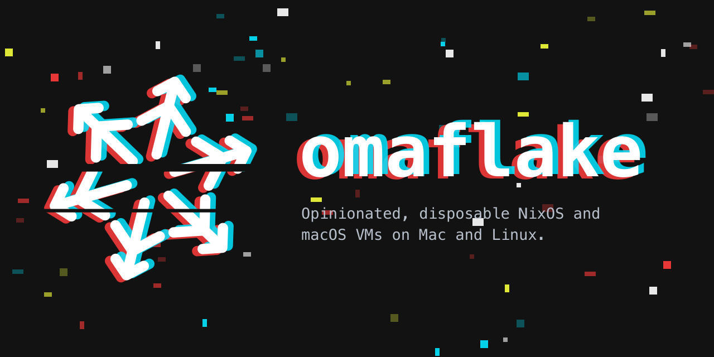

<p align="center">
  
</p>

# omaflake

Clean NixOS and macOS virtual machines on Mac and Linux – one click away.

**[Download](https://omaflake.app) · [Documentation](https://omaflake.dev) · [Changelog](docs/changelog.md) ·
[Recipes](https://github.com/omaflake/recipes)**

omaflake builds VM images from **recipes** you declare in Nix, and runs disposable **instances**
of them from an app (the menu bar on a Mac, a native window with a tray icon on Linux), `omaf ui` or the `omaf` CLI.
Images never change: *reset* throws an instance's state away and starts over from the image.

| Guest | Content | Runtime |
|---|---|---|
| **NixOS** (the host's architecture: aarch64, x86_64) | NixOS modules, built as UEFI qcow2 images | Mac: QEMU with Hypervisor.framework, own build with virglrenderer for 3D (`qemu/`); Linux: QEMU with KVM |
| **macOS** (Mac only) | nix-darwin modules on top of a base installed from Apple's IPSW | `omaf-runner`, one process per VM on Virtualization.framework |

| Host | Guests | Interfaces |
|---|---|---|
| **macOS** 27 on Apple silicon | NixOS and macOS | menu bar app (or window), `omaf ui`, `omaf` |
| **Linux** with Nix (or NixOS), x86_64 or aarch64 | NixOS | native app with tray icon, `omaf ui`, `omaf` – [docs/linux.md](docs/linux.md) |

> **Status:** early development – unsigned alpha releases ([changelog](docs/changelog.md)); signing, notarization and
> the first signed release are next (M12). Documentation: [omaflake.dev](https://omaflake.dev); see
> [docs/spec.md](docs/spec.md) for the design and [docs/plan.md](docs/plan.md) for findings and milestones.

## What it does

- **Mac and Linux:** on a Mac both guest kinds, on a Linux host NixOS guests – the same core, CLI and recipes.
- **Both guest kinds** from one menu bar window and the `omaf` CLI: NixOS (QEMU, 3D with virglrenderer) and macOS
  (Virtualization.framework, base installed from Apple's IPSW with no manual steps).
- **Templates (images)** built from recipes, with versions you can keep, pick as default or delete; builds queue,
  one per guest kind at a time, with step progress and a live log.
- **Integrations:** sound and microphone (both), shared clipboard with text and images (both), the host's camera in
  NixOS guests (on only while an app uses it), shared folders, dynamic resolution, ephemeral VMs.
- **Doctor:** checks what the computer brings; on a Mac it sets up Nix and nix-darwin with the Linux builder by click (macOS'
  administrator dialog), applies and cleans up the builder, checks for updates.
- **Developer mode:** the `lab` recipes with the "omaflake Test" app (camera, sound, microphone, clipboard) and debug
  tools; lab recipes stay hidden otherwise.

## Requirements

On a Linux host: Linux on x86_64 or aarch64 with KVM, Nix with flakes (or NixOS), QEMU with UEFI firmware and an SSH
key – details and install in [docs/linux.md](docs/linux.md). On a Mac:

- Mac with Apple silicon and macOS 27
- [Nix](https://nixos.org) with flakes and [nix-darwin](https://github.com/nix-darwin/nix-darwin) with
  `nix.linux-builder` (builds NixOS images) – the app's Doctor sets both up by click, the CLI with
  `omaf builder setup`; by hand: [docs/linux-builder.md](docs/linux-builder.md)
- QEMU for NixOS guests: omaflake's patched build as a Nix package, `nix build .#qemu` (3D); Homebrew QEMU works
  headless and 2D
- An SSH key in `~/.ssh`

`omaf doctor` (or the app's Doctor) checks all of this and shows how to set up what is missing.
- To build omaflake itself: Swift 6 toolchain (Xcode or Command Line Tools)

## Build

```sh
swift build -c release            # omaf CLI
swift test                        # unit tests
scripts/sign-runner.sh release    # omaf-runner, signed with com.apple.security.virtualization
scripts/bundle-app.sh             # build/omaflake.app (menu bar app; SIGN_IDENTITY=… for a Developer ID build)
```

CI: [.github/workflows/](.github/workflows/) – flake checks on every push, macOS build and tests, the QEMU package
with a binary cache, and signed, notarized releases on version tags (once the Developer ID exists).

## Recipes

omaflake ships no recipes. It reads them from **recipe sources** – by default
[omaflake/recipes](https://github.com/omaflake/recipes) (`minimal`, `research`, `lab` for NixOS and macOS); you can
add other GitHub repositories (also private ones, with a fine-grained token), any HTTPS folder with a `catalog.json`,
or a folder on your Mac. In the app: the Recipes tab (install, update, remove) and Settings → Recipe Sources. On the
command line:

```sh
omaf recipes available                     # what the sources offer
omaf recipes install omaflake/nixos/neovim-minimal
omaf build neovim-minimal
omaf new test --recipe neovim-minimal
omaf start test --wait
omaf ssh test
omaf sources add ~/src/my-recipes          # a folder: its recipes are used as they are on disk
```

Who you are in the guests – user, full name, SSH keys, locale, keyboard, time zone – comes from your Mac (and the
app's credentials), never from a recipe; every image is built from a recipe with a credential and a look (omaflake,
Catppuccin, Rosé Pine Dawn or each program's own colours). Images are built by omaflake's image flake ([nix/](nix/README.md)); the app
ships it, a checkout uses `omaf config --flake "$PWD/nix"`. Personal Nix extras for developers go into the
git-ignored `nix/local/` (template `nix/local.example/`). Writing recipes: omaflake/recipes' CONTRIBUTING.md;
the design: [docs/spec.md §11.3](docs/spec.md).

## macOS guests

```sh
omaf config --runner "$(scripts/sign-runner.sh release | tail -1)"
omaf macos install            # macOS from Apple (~27 GB) → ready base mac-base-<build>, no manual steps
omaf build macos/minimal      # image from the base + the recipe omaflake/macos/minimal (asks once for the sudo password)
```

Then run instances of it like NixOS ones:

```sh
omaf new mac1 --recipe macos/minimal      # APFS clone of the image, new machine identifier and MAC
omaf start mac1 --wait                    # headless; --window for a window
omaf ssh mac1
omaf stop mac1                            # clean shutdown via SSH
```

Set `macUser` in `nix/local/settings.nix` if the base's user differs from your NixOS guest user.

macOS allows at most two macOS VMs running at the same time per Mac.
Details: [docs/cli.md](docs/cli.md), [docs/macos-base.md](docs/macos-base.md).

## Documentation

| | |
|---|---|
| [docs/spec.md](docs/spec.md) | goals, scope, architecture, milestones, open points |
| [docs/plan.md](docs/plan.md) | verified findings (B…, BM…), milestone checklists |
| [docs/cli.md](docs/cli.md) | `omaf` and `omaf-runner` commands |
| [docs/app.md](docs/app.md) | menu bar app |
| [docs/linux.md](docs/linux.md) | omaflake on a Linux host: requirements, KVM, the Linux app |
| [docs/macos-base.md](docs/macos-base.md) | what a macOS base contains and how it is built |
| [docs/linux-builder.md](docs/linux-builder.md) | building NixOS images on a Mac |
| [nix/README.md](nix/README.md) | the image flake, its inputs and your local settings |
| [qemu/README.md](qemu/README.md) | QEMU build with virglrenderer |
| [brand/README.md](brand/README.md) | design tokens and the copies of the artwork; the brand kit itself is [omaflake/brand](https://github.com/omaflake/brand) |

## The name

```
OMAkase + FLAKE → omaflake
```

*Omakase* is Japanese for "I'll leave it to you": at a sushi bar, the chef chooses. Omarchy, the opinionated Arch
Linux setup, took its name from it, and omaflake follows – a recipe chooses a whole system for you, ready to use. A
*flake* is Nix's unit of reproducible code: it pins exactly what goes into a system, so the result is the same every
time. Together: the chef's choice, reproducible.

## License

omaflake is free software: you can redistribute it and/or modify it under the terms of the **GNU Affero General
Public License, version 3 or (at your option) any later version** (`AGPL-3.0-or-later`), see [LICENSE](LICENSE).
Copyright © 2026 falkOSS – Falcon Lake Open Source Software gUG (haftungsbeschränkt) i. G. and the omaflake contributors – omaflake
is a project of [falkOSS](https://falkoss.org). Every file names its licence – in an SPDX header or in
[REUSE.toml](REUSE.toml) ([REUSE](https://reuse.software), checked in CI); the texts are in [LICENSES/](LICENSES/).
The recipes and modules in [omaflake/catalog](https://github.com/omaflake/catalog) are MIT licensed, so they can be
copied and adapted freely. The logo and icons in `brand/` are copies from [omaflake/brand](https://github.com/omaflake/brand)
under CC BY-ND 4.0; omaflake's name and brand are not covered by any licence. Third-party parts keep their licenses:
the QEMU patches in `qemu/patches/` modify QEMU and are GPL-2.0-or-later like QEMU itself;
patches taken from try-omarchy are MIT ([qemu/patches/try-omarchy/LICENSE](qemu/patches/try-omarchy/LICENSE)),
startergo's virglrenderer/libepoxy patches are MIT ([qemu/patches/startergo/NOTICE](qemu/patches/startergo/NOTICE)).
omaflake IDs use BIP-39's English word list (bitcoin/bips, MIT), unchanged in
[crates/omaflake-core/src/word_list.rs](crates/omaflake-core/src/word_list.rs).
ANGLE comes from nixpkgs (BSD-3-Clause); see [qemu/README.md](qemu/README.md) for all versions.
